# UI/UX · Exemplos

## Gestalt

| Glifo | Lei | Resumo | No front |
|:---:|---|---|---|
| 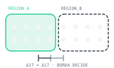 | [Law of Common Region](https://lawsofux.com/law-of-common-region) | Elementos dentro da mesma borda formam grupo | Card, borda ou fundo para agrupar campos |
| 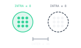 | [Law of Proximity](https://lawsofux.com/law-of-proximity) | Elementos próximos formam grupo | Espaço menor dentro do grupo, maior entre grupos |
| 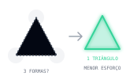 | [Law of Prägnanz](https://lawsofux.com/law-of-pragnanz) | Forma complexa é lida na versão mais simples | Ícone e layout com formas simples |
| 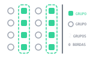 | [Law of Similarity](https://lawsofux.com/law-of-similarity) | Elementos parecidos são vistos como grupo | Mesmo estilo para a mesma função |
| 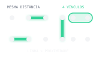 | [Law of Uniform Connectedness](https://lawsofux.com/law-of-uniform-connectedness) | Elementos conectados visualmente parecem relacionados | Linha ou cor ligando etapas de um fluxo |

## Decisão e esforço

| Glifo | Lei | Resumo | No front |
|:---:|---|---|---|
| 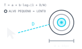 | [Fitts's Law](https://lawsofux.com/fittss-law) | Tempo até o alvo depende da distância e do tamanho | Botão grande, perto da ação; alvo de toque ≥ 44px |
| 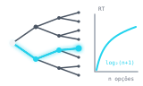 | [Hick's Law](https://lawsofux.com/hicks-law) | Mais opções, decisão mais lenta | Menos opções por tela; destaque a recomendada |
| 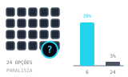 | [Choice Overload](https://lawsofux.com/choice-overload) | Opções demais travam a decisão | Filtro, busca e comparação lado a lado |
|  | [Cognitive Load](https://lawsofux.com/cognitive-load) | Esforço mental para usar a interface | Remova o que não ajuda a tarefa |
| 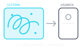 | [Tesler's Law](https://lawsofux.com/teslers-law) | Toda tarefa tem complexidade que não some | O sistema absorve a complexidade, não o usuário |
| 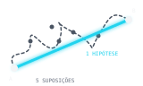 | [Occam's Razor](https://lawsofux.com/occams-razor) | Prefira a solução com menos suposições | Corte elemento até que nada sobre |
| 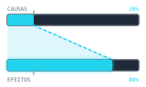 | [Pareto Principle](https://lawsofux.com/pareto-principle) | 80% do efeito vem de 20% das causas | Priorize os fluxos mais usados |
| 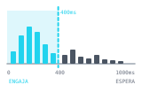 | [Doherty Threshold](https://lawsofux.com/doherty-threshold) | Produtividade sobe com resposta < 400 ms | Feedback imediato; skeleton e UI otimista |

## Memória e atenção

| Glifo | Lei | Resumo | No front |
|:---:|---|---|---|
| 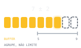 | [Miller's Law](https://lawsofux.com/millers-law) | Memória de trabalho guarda 7 ± 2 itens | Não use como limite fixo; agrupe a informação |
| 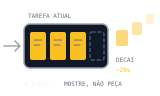 | [Working Memory](https://lawsofux.com/working-memory) | Memória temporária para a tarefa atual | Mostre o dado em vez de pedir para lembrar |
| 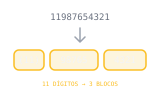 | [Chunking](https://lawsofux.com/chunking) | Informação em blocos é mais fácil de reter | Telefone, CPF e cartão em grupos |
| 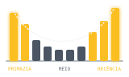 | [Serial Position Effect](https://lawsofux.com/serial-position-effect) | Primeiro e último itens são mais lembrados | Ação principal no início ou no fim |
| 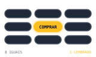 | [Von Restorff Effect](https://lawsofux.com/von-restorff-effect) | O item diferente é o mais lembrado | Um único destaque por tela |
| 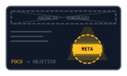 | [Selective Attention](https://lawsofux.com/selective-attention) | Atenção vai só ao que importa para a meta | Não esconda o essencial em área de anúncio |
|  | [Zeigarnik Effect](https://lawsofux.com/zeigarnik-effect) | Tarefa incompleta é mais lembrada | Barra de progresso e checklist |

## Comportamento

| Glifo | Lei | Resumo | No front |
|:---:|---|---|---|
|  | [Jakob's Law](https://lawsofux.com/jakobs-law) | Usuário espera que seu site funcione como os outros | Siga padrões conhecidos de navegação e formulário |
|  | [Mental Model](https://lawsofux.com/mental-model) | Usuário age pelo que acha que o sistema faz | Nomes e fluxos com a linguagem do usuário |
| 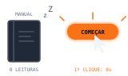 | [Paradox of the Active User](https://lawsofux.com/paradox-of-the-active-user) | Usuário não lê manual, começa usando | Ajuda contextual: tooltip e estado vazio |
| 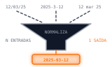 | [Postel's Law](https://lawsofux.com/postels-law) | Seja liberal no que aceita, conservador no que envia | Aceite máscara, espaço e formato variado no input |
| 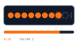 | [Goal-Gradient Effect](https://lawsofux.com/goal-gradient-effect) | Motivação cresce perto da meta | Mostre quanto falta para concluir |
| 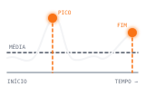 | [Peak-End Rule](https://lawsofux.com/peak-end-rule) | Experiência é julgada pelo pico e pelo fim | Capriche no sucesso e na tela final |
|  | [Aesthetic-Usability Effect](https://lawsofux.com/aesthetic-usability-effect) | Bonito parece mais fácil de usar | Visual cuidado, sem esconder problema de uso |
| 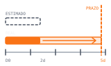 | [Parkinson's Law](https://lawsofux.com/parkinsons-law) | Tarefa ocupa todo o tempo disponível | Autopreenchimento e menos passos |
| 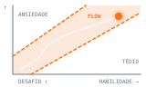 | [Flow](https://lawsofux.com/flow) | Imersão total quando desafio e habilidade se equilibram | Sem interrupção no meio da tarefa |
| 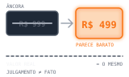 | [Cognitive Bias](https://lawsofux.com/cognitive-bias) | Erros sistemáticos de julgamento | Teste com usuário real, não com suposição |

## Exemplos

| Exemplo | Lei | Mudança |
|---|---|---|
|  | Lei da Região Comum | Caixas: Entrega e Pagamento |
|  | Lei da Proximidade | Label colado; grupos afastados |
| 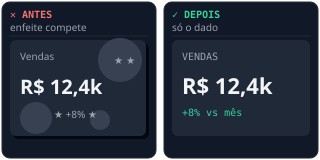 | Lei de Prägnanz | Só rótulo, número e variação |
| 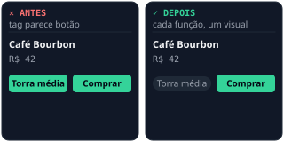 | Lei da Similaridade | Tag neutra; só ação vira botão |
| 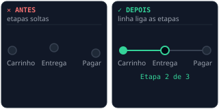 | Lei da Conexão Uniforme | Linha conecta as etapas |
| 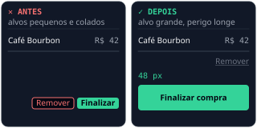 | Lei de Fitts | Finalizar largo; Remover longe |
|  | Lei de Hick | 1 recomendado; resto em Ver mais |
| 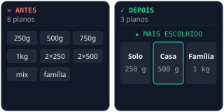 | Sobrecarga de Escolha | 3 planos; o do meio destacado |
| 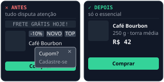 | Carga Cognitiva | Sem banner, popup e selos extras |
| 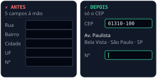 | Lei de Tesler | Só o CEP; sistema preenche |
| 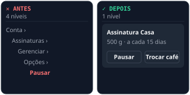 | Navalha de Occam | Pausar e Trocar no próprio card |
|  | Princípio de Pareto | 2 ações à vista; 6 em Mais |
| 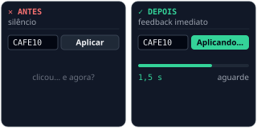 | Limiar de Doherty | Aplicando… e barra no clique |
|  | Lei de Miller | Campos agrupados em 3 blocos |
|  | Memória de Trabalho | Mostrar o CEP, não pedir |
| 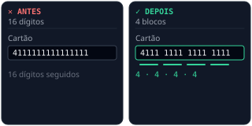 | Agrupamento | Cartão em 4 blocos de 4 |
| 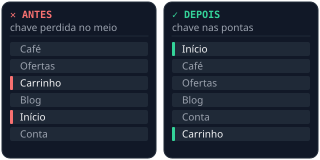 | Efeito de Posição Serial | Início primeiro, Carrinho por último |
|  | Efeito Von Restorff | Um único selo de destaque |
|  | Atenção Seletiva | Erro colado ao campo |
|  | Efeito Zeigarnik | Barra 1 de 4, passo feito |
| 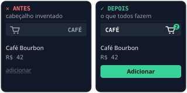 | Lei de Jakob | Logo à esquerda, carrinho à direita |
| 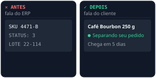 | Modelo Mental | Nome do café e status claro |
|  | Paradoxo do Usuário Ativo | Sem tour; ajuda no campo |
| 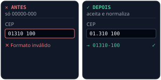 | Lei de Postel | Aceita espaço e ponto; formata |
| 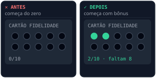 | Efeito Gradiente de Meta | Cartão começa com 2 selos |
|  | Regra do Pico-Fim | Confirmação, prazo e rastreio no fim |
| 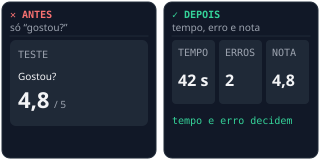 | Efeito Estética-Usabilidade | Medir tempo e erro, não só nota |
|  | Lei de Parkinson | Duração visível antes de começar |
|  | Fluxo | Nenhum popup durante o pagamento |
|  | Viés Cognitivo | Desmarcado, separado, recusa neutra |
